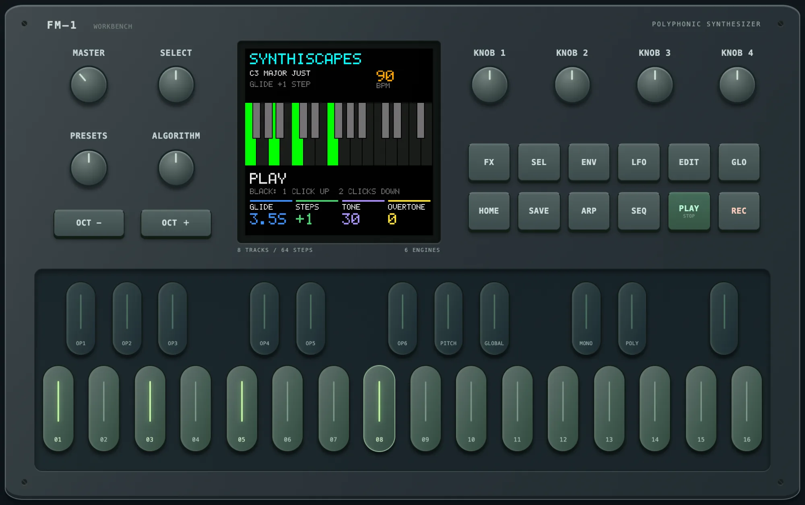
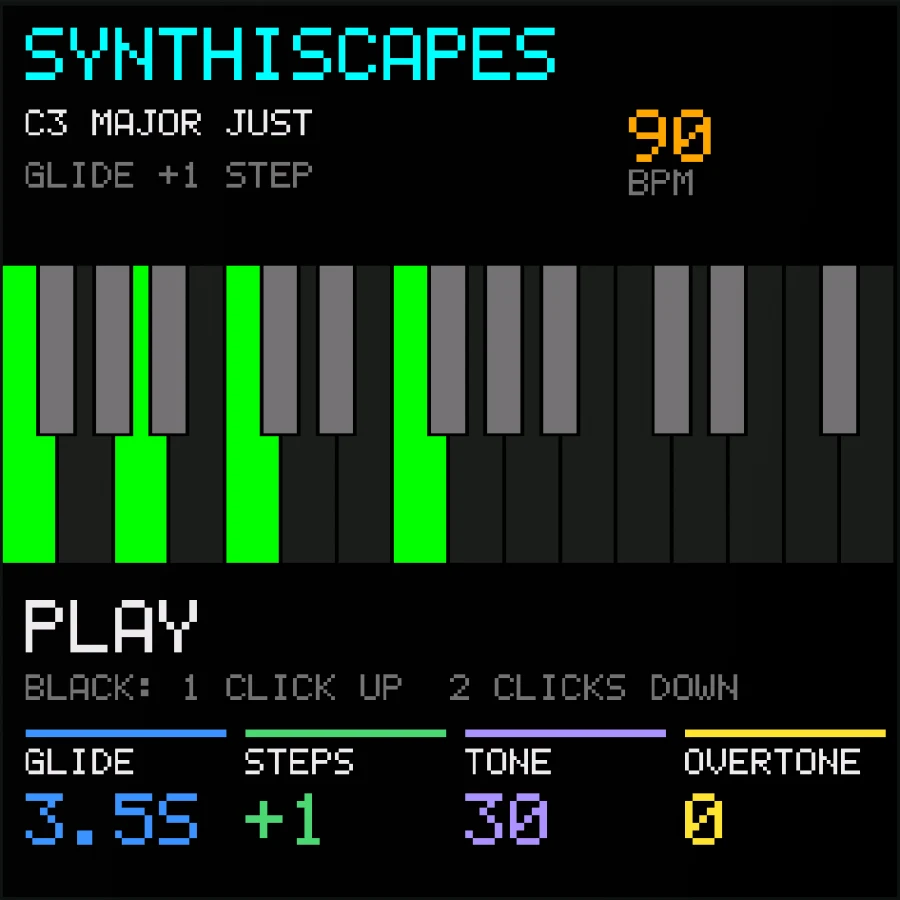
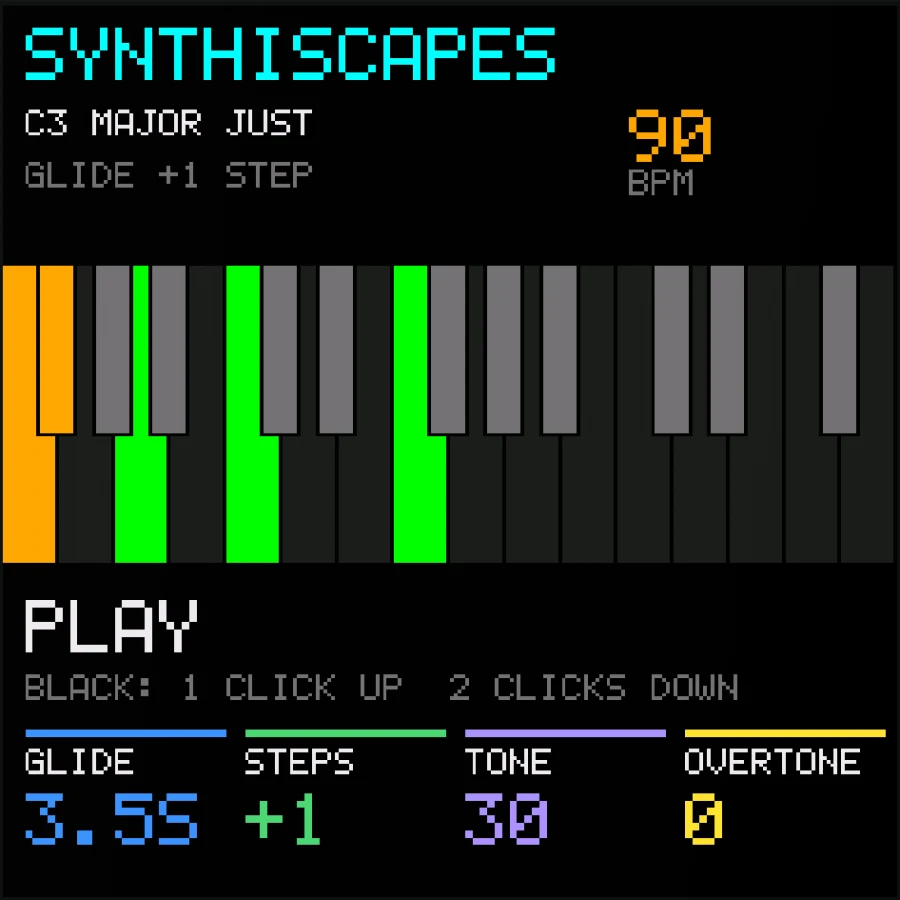
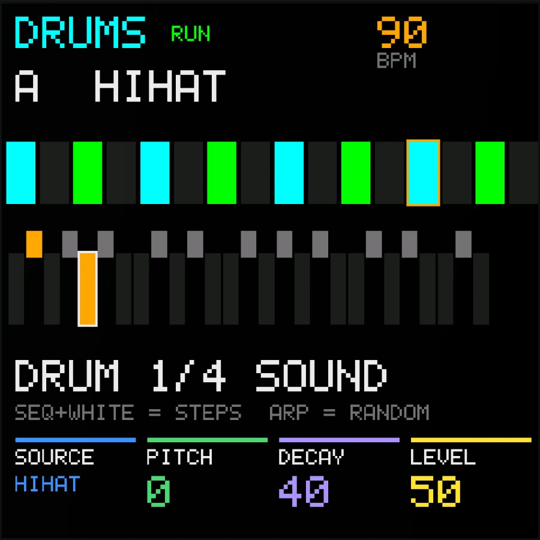

# GLIDER – drone synth firmware for the M-VAVE FM-1

GLIDER is a custom firmware for the **M-VAVE FM-1**. It turns the FM-1 into a
drone instrument: white keys latch tones on and off, black keys glide them
up or down the scale like a steel guitar, and everything stays in the chosen
key and scale. Warm two-oscillator voices with overtones, undertones and slow
motion, a tape echo that can self-oscillate, a ladder filter, a delay and a
strong shimmer reverb, plus a quiet microsound drum track underneath.

<p align="center"></p>

<p align="center">  </p>

<p align="center"><b><a href="https://subcity.at/flash/fm1-glider/">Install in the browser</a></b> · <a href="https://subcity.at/demo/fm1-glider/">Try the simulator</a> · <a href="https://subcity.at/fm1-glider/">Downloads &amp; guide</a></p>

> **Beta – a hobby project.** GLIDER runs on a real FM-1 (tested on one unit,
> October 2026). Test reports from more FM-1 owners are very welcome. No
> support is promised.

Built on [M-VAVE FM1 Open](https://github.com/m-vave/fm1_open) (V14); the
original README is kept in [README.fm1-open.md](README.fm1-open.md). Sister
project: [GLITCH](https://github.com/ttreu/fm1-glitch), a microsound drum
machine for the FM-1.

## What it does

- **Latching keys:** each white key switches a scale tone on or off; 16 tones
  sound at once. OCT -/+ moves the keyboard by up to two octaves while the
  sounding tones stay.
- **Steel glides:** a black key glides the white key on its left by 1-4 scale
  steps – one click up, a double click down, the next click back home.
- **Key and scale:** 25 scales, chords as scales (sus2, maj7, min9 ...), equal
  or just intonation. Hold SEL and press a white key to change the key.
- **Sound:** two oscillators, an interval voice (in key or pure), overtones,
  undertones and FLOAT motion, detune LFO, 22 presets.
- **Effects:** tape echo, ladder filter, delay, shimmer reverb, tempo sync,
  tap tempo and MIDI clock.
- **Drums:** 27 slots of synthesized microsounds (no samples), 16 steps each,
  probability, ratchets, scatter and random beats.
- **CPU guard:** under heavy load the oldest tone fades out instead of the
  audio breaking up.
- **MIDI:** notes play the keyboard, channel 10 plays the drums.

The full manual is [GLIDER.md](GLIDER.md).

## Install

**In the browser:** open [subcity.at/flash/fm1-glider](https://subcity.at/flash/fm1-glider/) in Chrome or
Edge, connect the FM-1 by USB and use *Device update* (coming from the stock firmware:
*Recovery & force update*). The page also holds the original M-VAVE V15 firmware to go back.
The same page is in the download on [subcity.at/fm1-glider](https://subcity.at/fm1-glider/), together with the source code.

**Before flashing:** back up your projects, voices and samples with the
firmware that is on the device now. GLIDER does not use them, but they stay
in Flash.

With FM1 Open firmware already on the device, macOS users can also flash from
the command line: `python3 tools/flash_fm1.py flash` (see GLIDER.md).

## Build

macOS: see *Building on macOS* in [GLIDER.md](GLIDER.md) (JieLi toolchain
under Wine, WASI SDK for the browser simulator). Tests:

```
tests/run_native.sh                  # DSP tests
node tests/steel_sim_test.mjs        # simulator: keys, glides, effects, tempo, MIDI
node tests/steel_drums_sim_test.mjs  # simulator: drum track
node tests/steel_rhythm_check.mjs    # drum rhythm measurements
```

## Test reports and contributions

The biggest help is a test on a real FM-1: please open an issue with the
firmware build, what you played, the CPU figure on FX page 5 and anything
that crackled, hung or sounded wrong. Bug reports, ideas and pull requests
are welcome and will be looked at when there is time. Forks under their own
name are fine (GPL).

## License

The firmware sources are GPL-3.0-only with the FM1 linking exception
([LICENSE.md](LICENSE.md)). The FM1 binary SDK, boot files and the V15
recovery image keep their own terms ([THIRD_PARTY.md](THIRD_PARTY.md)).
GLIDER is not an M-VAVE product and comes without warranty; flashing is at
your own risk.
